# SimpleMesh

**WORK IN PROGRESS: MANY FEATURES MAY BE BROKEN** · version `0.5.0-wip` · pre-release

**Free software · GPL-3.0-only** · Copyright (C) 2026 Matthew Armstrong · **No warranty, no liability: use at your own risk.** See [LICENSE](LICENSE) and [THIRD_PARTY.md](THIRD_PARTY.md). Not legal advice.

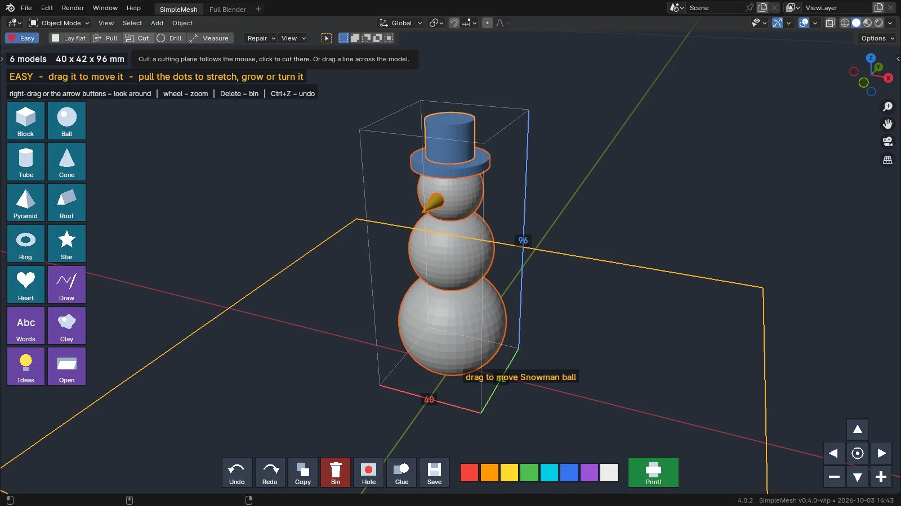

> **About the screenshots:** they are the real Blender 4.0.2 window with SimpleMesh loaded, captured on a virtual display (software rendering) while a script moved the mouse and pressed keys (`tests/gui_session.py`). **No person, and no child, has used this version by hand yet**, so how it *feels* is unproven. See [what is tested](#what-is-tested-and-what-is-not).

A Blender add-on that turns Blender into a plain **make-and-print workbench**. No scenery, no animation timeline, no game-asset tooling. It has two levels:

- **Easy mode** (what Blender now starts in): big picture buttons aimed at a ten-year-old. Build things out of shapes, your own drawings, words and clay, colour them in, press **Print!**.
- **The panel**: big buttons across the top of the 3D view, there in every mode, for editing STL files exactly: lay flat, move, turn, size, pull a face, cut, drill, measure, mould like clay, with millimetres. It is the same idea as SimpleCAD's deck: a big red button that does the next obvious thing, a green badge that says what is active, and keys for the look.

It is the Blender sibling of [SimpleCAD](https://github.com/The-Dorkknight/simplecad).

## Easy mode

**To make something:** click a picture, move the mouse, click to put it down. A shape sits on **whatever is under the mouse**: the floor, or the top or side of another shape, so things stack and stick the way you expect.

| Left side: things to add | |
|---|---|
| **Block, Ball, Tube, Cone, Pyramid, Roof, Ring, Star, Heart** | Ready-made shapes. |
| **Draw** | Hold the mouse button and draw a loop on the floor. It becomes a solid shape. Wobbly lines, crossed lines and scribbles still give something solid. |
| **Words** | Type a word or your name and get 3D letters. |
| **Clay** | Squish and pull the chosen shape (or a new ball) like clay, then press Done. Turn on **Mirror** for faces and creatures. |
| **Ideas** | Start from a snowman, house, rocket, robot or car made of shapes, then change it. |
| **Open** | Load a model file somebody else made. |

**To change a shape:** click it. Drag it to move it. It has six dots:

| Dot | Pull it to... |
|---|---|
| white (top corner) | make it bigger or smaller |
| red / green / blue | make it longer / wider / taller |
| orange | spin it round |
| purple | tip it over |

| Along the bottom | |
|---|---|
| **Undo / Redo** | Go back a step. Nothing can be broken. |
| **Copy / Bin** | Another one the same / throw it away. |
| **Hole** | Turns the chosen shape into a hole (it goes red). Push it into another shape; Glue or Print! cuts it out. |
| **Glue** | Sticks the shapes together into one. |
| **Save** | Keeps your project so you can carry on another day (it reopens in Easy mode). |
| **Colours** | Colour in the chosen shape. (Colours are for you; a printer prints in whatever plastic is loaded.) |
| **Print!** | Cuts out the holes, glues what touches, repairs everything, sits it on the bed, tells you if it is too big, and saves the file for the printer. |

Bottom right: **arrow buttons turn the view**, + and − zoom, the middle one shows everything. You can also drag with the right mouse button to look around.

| | |
|---|---|
| 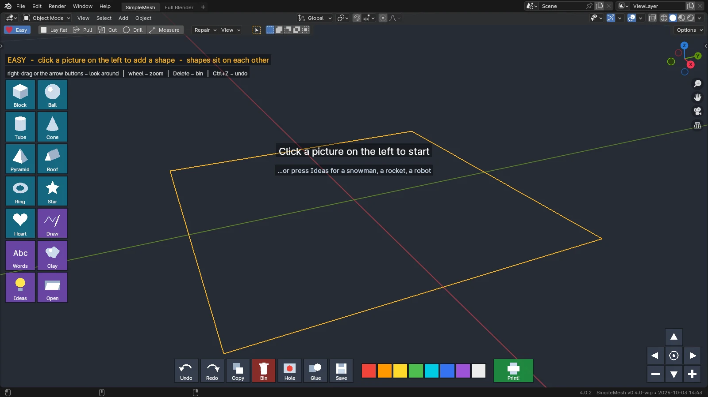 What Blender looks like when it starts | 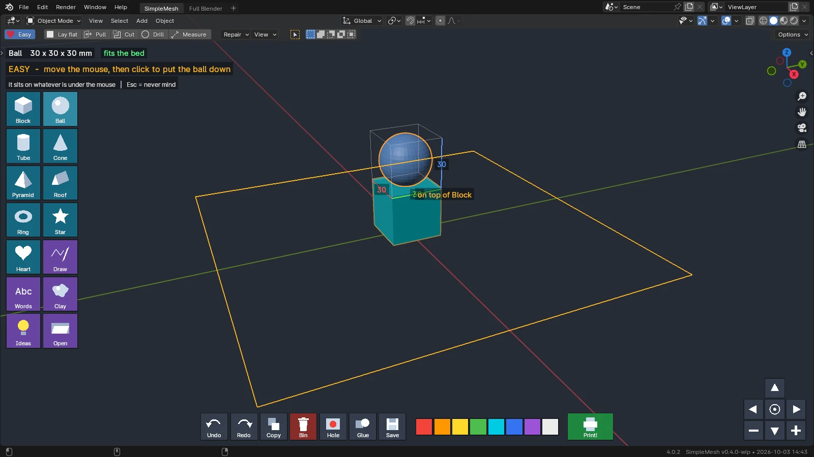 A ball being put on top of a block |
| 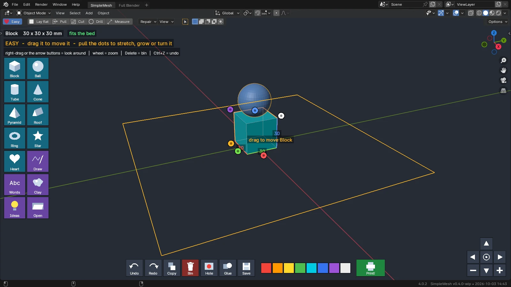 The six dots on the chosen shape | 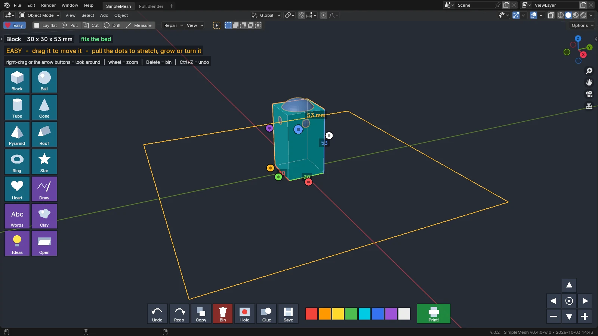 Pulling the blue dot: taller |
| 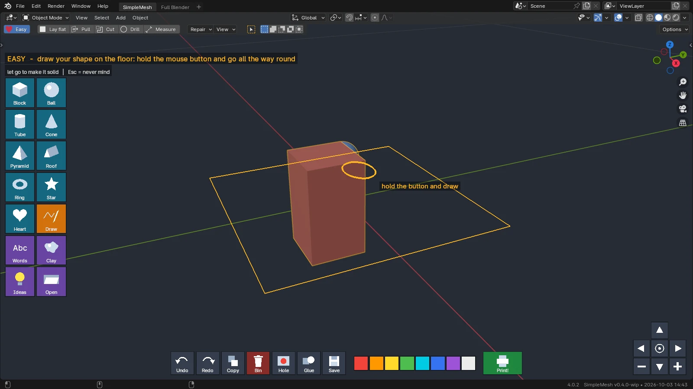 Draw a loop on the floor... | 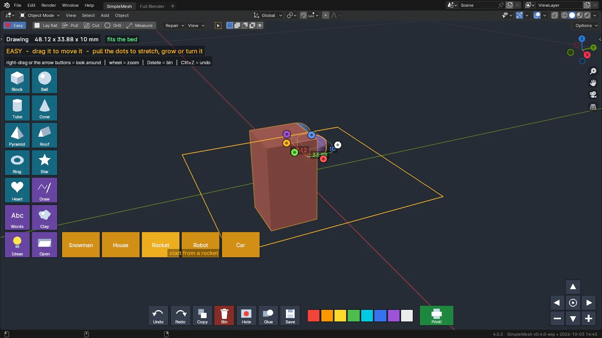 Ideas: ready-made starters |

The **Easy** key on the panel turns Easy mode off and on. With it off you select models by clicking and use the panel's tools described next. To make Blender start with it off, untick *Start in Easy mode* in the add-on's preferences.

**What "anything you can imagine" really means here:** anything you can build from those shapes, your own drawn outlines, letters and clay, stuck together and with holes cut out. That covers a lot (characters, vehicles, buildings, name tags, cookie cutters, creatures) but it is not everything: no screw threads, no exact engineering fits, and very thin clay shapes may not print.

## The panel (big buttons)

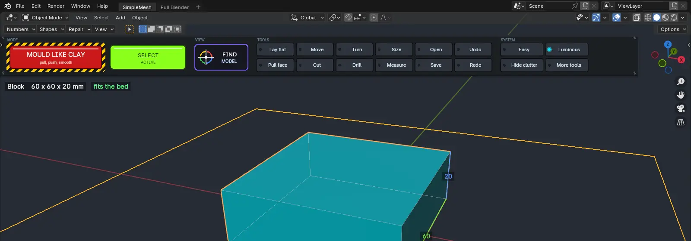

| Part | What it does |
|---|---|
| **The big red button** | The next obvious thing. Normally **MOULD LIKE CLAY**. While a tool is on: **FINISH** that tool. While moulding: **DONE**. In one of Blender's own modes: **BACK TO THE MODELS**. In Blender's own Sculpt Mode before the model is ready: **GET READY TO MOULD**. |
| **The green badge** | What is active right now: SELECT, EASY, LAY FLAT, CLAY: PULL... |
| **FIND MODEL** | Centres the view on the model (same as **F**). |
| **Tool keys** | Lay flat, Move, Turn, Size, Pull face, Cut, Drill, Measure, Open, Save, Undo, Redo. The key of the tool that is on has its light lit. While moulding they become the seven brushes plus **Brush +**, **Brush -** and **Mirror**. |
| **Easy** | Picture buttons on or off. |
| **Luminous** | Switches between the dark, high-contrast look and the light, clean one. |
| **Hide clutter** | Hides Blender's own menu rows and status bar; press again to bring them back. The panel stays. |
| **More tools** | Exact numbers, shapes and holes, check and repair, view settings, **Look** (below), and *Report a problem*. |

The panel is drawn inside the 3D view (Blender's own header rows cannot hold big buttons), ends short of the right edge so Blender's view ball stays free, and shrinks its buttons on a narrow window. Hover over a button and a line under the panel says what it does. Switch it off in **More tools ▸ Big-button panel** and the tools go back to the thin strip in Blender's header.

| | |
|---|---|
| 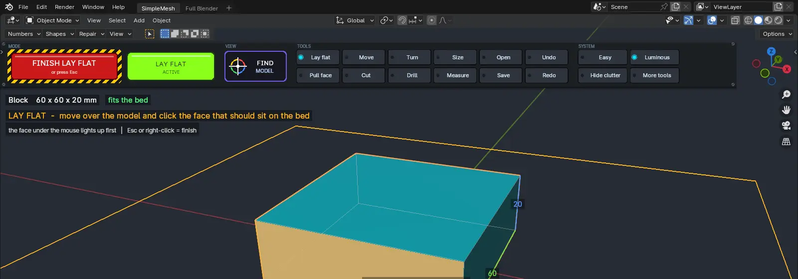 Lay flat is on: its light is lit, the red button says FINISH LAY FLAT | 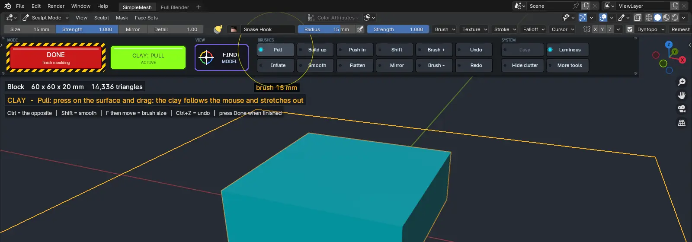 While moulding: DONE, and the brushes |
| 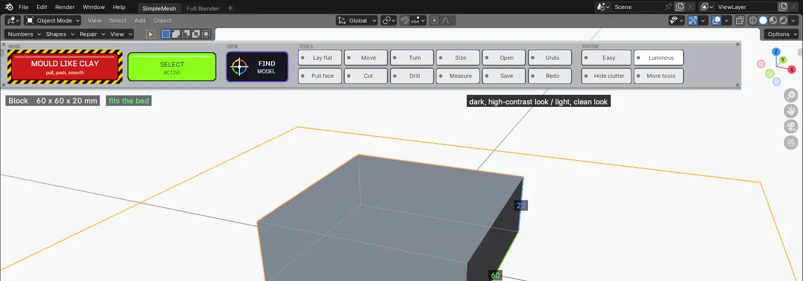 The Clean look | 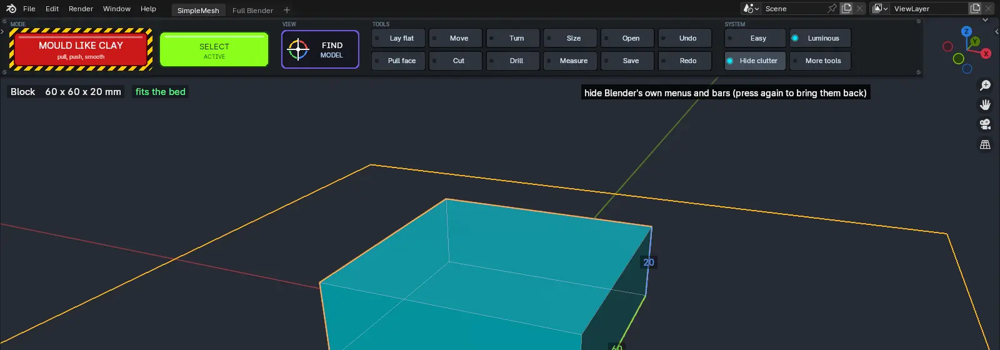 Hide clutter: Blender's rows are gone |

### Look

**More tools ▸ Look** (also in the strip's **View** pop-up):

- **Luminous** (near-black background, cyan models, orange outline), **Clean** (light background, soft blue-grey) or **Blender default**. The **Luminous** key on the panel switches between the first two.
- **Rainbow**: every model gets a colour of its own, which shows at a glance which parts are separate.
- **Show the triangles**: the triangles of the STL drawn on the model.
- **See-through**, **Show flipped faces (red)**, **Show size on the model**.

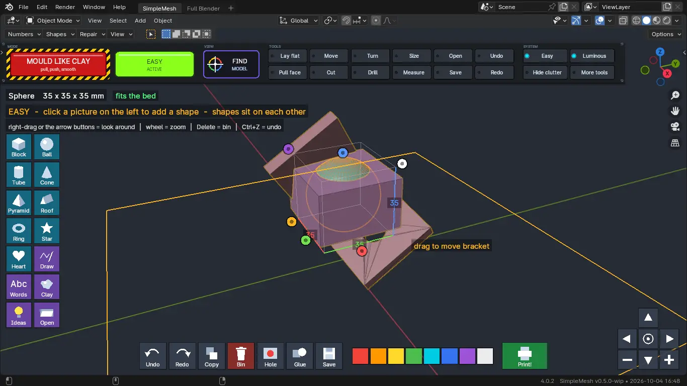

## The tools

1. **Open** an STL. It arrives in millimetres at a sensible size (a 5200 mm monster is divided by 10 until it fits your bed), sitting on the bed, in the middle of the view. Its size and "fits the bed" are written in the top-left corner all the time.
2. Pick a tool on the panel, then **do it on the model**. The view shows what a click will do before you click. Orbit and zoom keep working. **Esc** or right-click leaves the tool. **Ctrl+Z** undoes.
3. **Save** writes a millimetre STL as `<name>_edited.stl`.
4. Lost the model? Press **F** (or *Find*).

| Tool | What you do | Extras |
|---|---|---|
| **Lay flat** | Move over the model: the flat face under the mouse lights up. Click: that face sits on the bed. | No Edit Mode. |
| **Move** | Drag a model: it slides across the bed. | Shift+drag lifts it. Arrow keys 1 mm (Shift 10, Ctrl 0.1). D = drop to bed, C = centre. |
| **Turn** | Drag a model sideways: it spins in 15° steps and is put back on the bed. | X / Y / Z choose the direction. Arrow keys = 90°. Type an angle + Enter. Shift = fine. |
| **Size** | Drag away from the model = bigger, towards it = smaller. Or **type the longest side in mm + Enter**. | X / Y / Z stretch one direction only. Ctrl = whole millimetres. Scale stays 1.0. |
| **Pull** | Point at a flat face (it lights up) and **drag it out or in**: the part gets longer or shorter. Or point and type mm + Enter. | Steps of 0.5 mm; Ctrl = whole mm; Shift = free. Minus key = inwards when typing. |
| **Cut** | A red plane follows the mouse over the model; click to cut there. **Or drag a line across the model** to cut along it. | X / Y / Z direction. Type a height in mm + Enter. K = keep both / one side. L = lay the cut faces on the bed. Cuts are capped. |
| **Drill** | A red circle follows the mouse on the surface; click to drill a round hole. | Type the diameter + Enter, or + / −. T = through / blind, [ ] = depth. Ctrl = centre of the face. |
| **Measure** | Click two points. | Snaps to corners. Shows the distance and its X / Y / Z parts. |

### Clay: mould it like clay

Clay is for free-form changes: click a model, press the red **MOULD LIKE CLAY** button (or the Clay picture in Easy mode), and the panel's keys become seven brushes. Press on the surface and drag. Choosing *Sculpt Mode* from Blender's own mode menu ends up in the same place: SimpleMesh does the Clay set-up by itself.

| Brush | What it does |
|---|---|
| **Pull** | The clay follows the mouse and stretches out. Pull a lump, a horn, a handle out of a flat face. |
| **Build up** / **Push in** | Rub to raise the surface / press it in. |
| **Shift** | Slide an area sideways without stretching it. |
| **Inflate** | Swell outwards in all directions. |
| **Smooth** / **Flatten** | Rub out lumps / level an area. |

Brush **Size is in millimetres** and stays the same at any zoom; it starts at a fifth of the model. **Brush +** and **Brush -** on the panel change it (or **F**, then move the mouse). Holding **Ctrl** does the opposite, holding **Shift** smooths, **Ctrl+Z** undoes a stroke. The read-out shows how many triangles the model has and warns in red when it is getting heavy. Press the red **DONE** button to go back to the normal tools.

Underneath it is Blender's own sculpting engine, set up for STL work: the model is first given small triangles everywhere (its shape does not change) because an STL's big flat triangles have nothing to mould; more are added under the brush as you work; mirror symmetry is off; and when you press **Done** the flat areas you did not touch are merged back into big triangles so the file stays small. **Detail** (the size of the new triangles, in the header row) cannot be set finer than a thirtieth of the brush: a big brush with a tiny Detail makes Blender cut hundreds of thousands of triangles in one drag and stop answering.

| | |
|---|---|
| 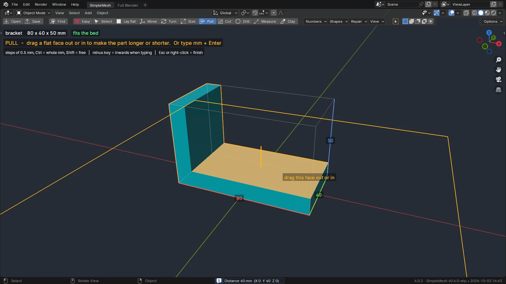 Pull: point at a flat face... | 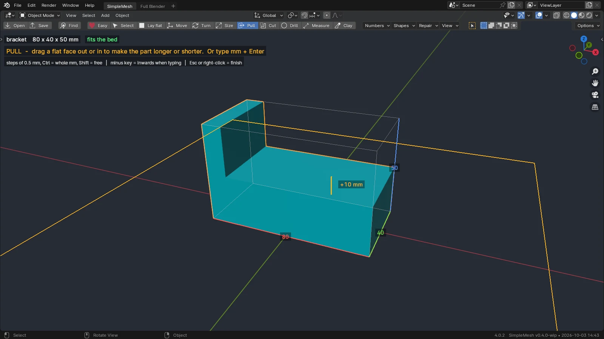 ...and drag it: +10 mm |
| 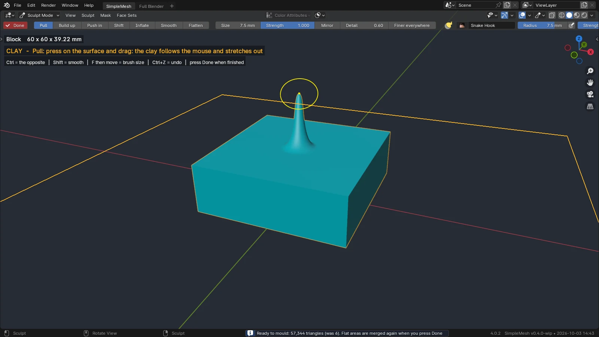 Clay ▸ Pull: a horn pulled out of a flat face | 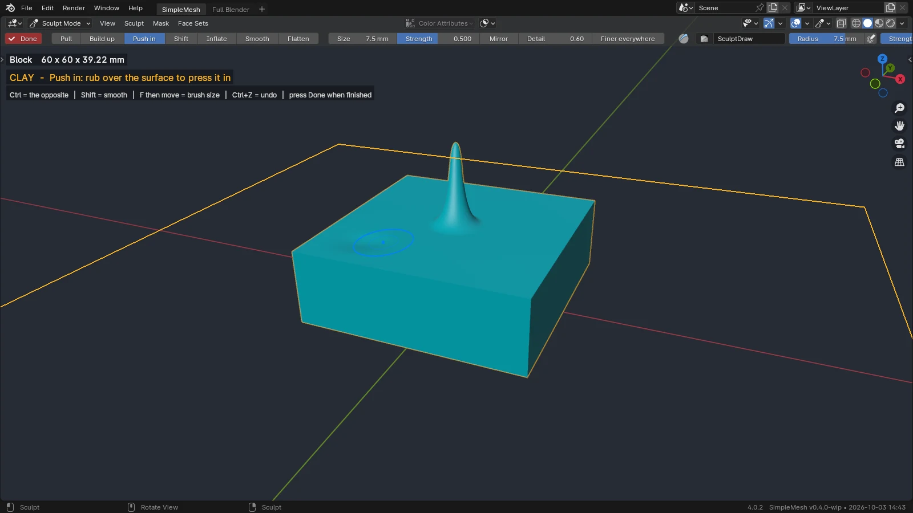 Clay ▸ Push in |

Pop-ups in Blender's header row (and under **More tools** on the panel) hold the things that need numbers or are used less often:

- **Numbers**: ÷1000 ÷100 ÷10 ×10 ×1000, inch ↔ mm, set the longest side, exact X/Y/Z, drop / centre / auto lay flat, 90° turns, mirror, hole and cut settings.
- **Shapes**: add a block, cylinder, sphere or cone sized in mm. **Make it a hole** turns any shape into a red wire "hole"; **Cut the holes out** removes every hole from whatever it touches (no "select the cutter, then the base"). Weld together, separate loose pieces, copy, delete.
- **Repair**: Check (triangles, volume, surface, holes, inside-out faces), one-click Repair, Simplify.
- **View**: standard views, show everything, looks (Luminous / Clean / Blender default), show flipped faces, laptop navigation (no middle button needed), printer bed size (presets for FlashForge Adventurer 5M, Bambu Lab A1, Creality Ender 3 V2).

| | |
|---|---|
| 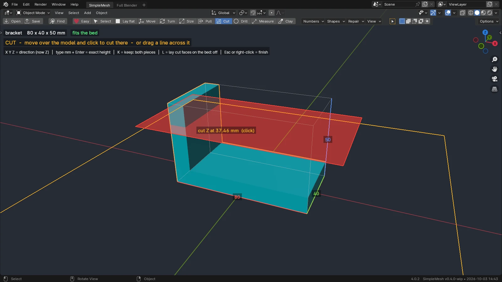 Cut: the plane follows the mouse | 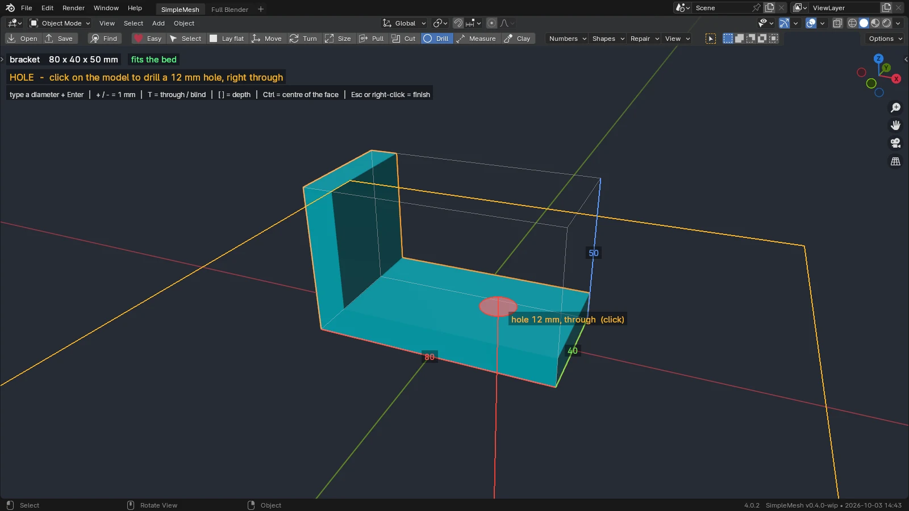 Hole: the circle follows the mouse |
|  Cut: drag a line across | 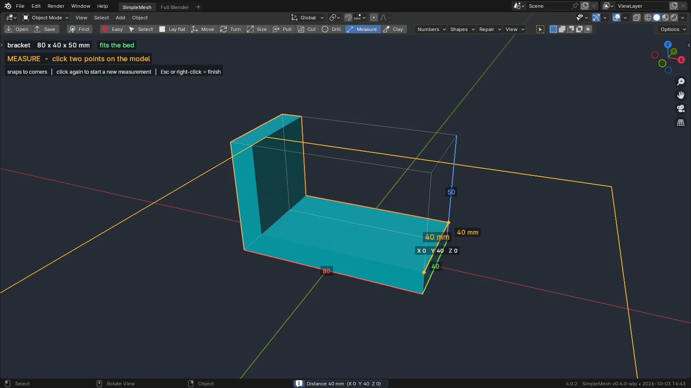 Measure |
| 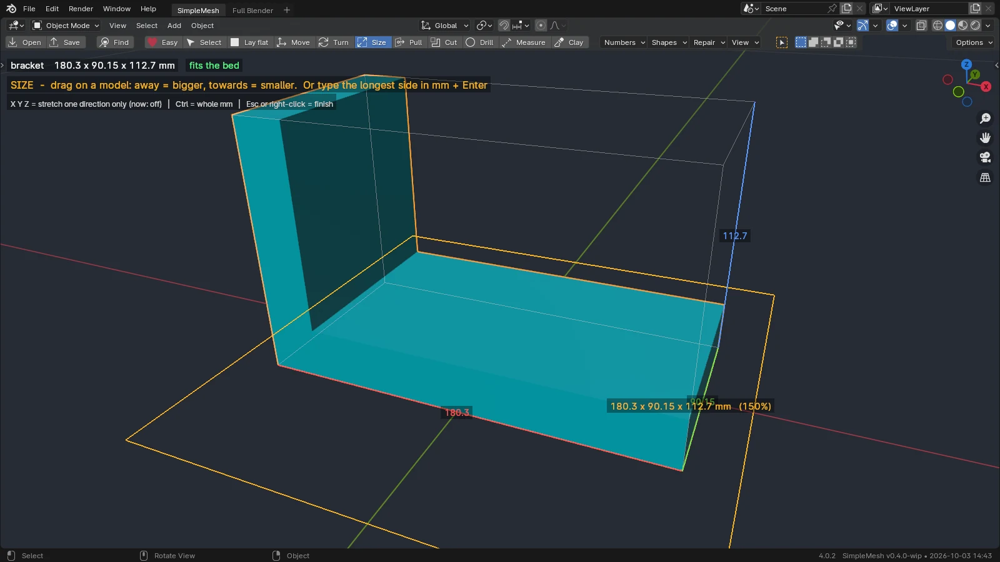 Size: drag, or type | 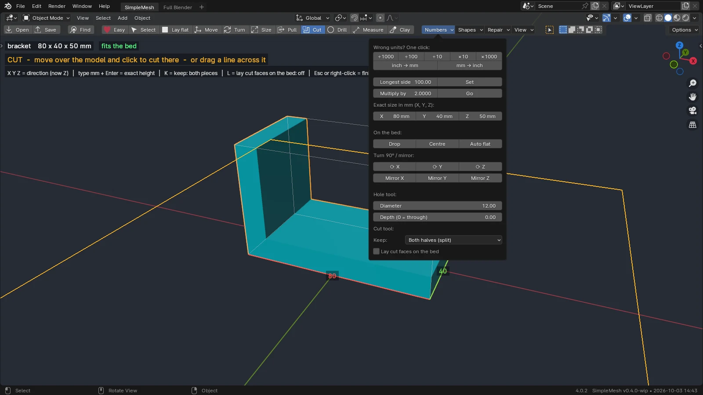 The Numbers pop-up |
| 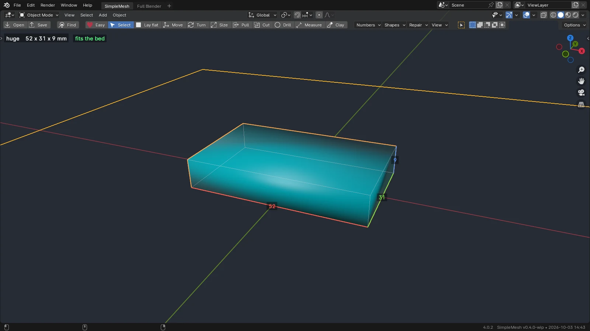 A 5200 mm STL after Open: shrunk to fit, centred | 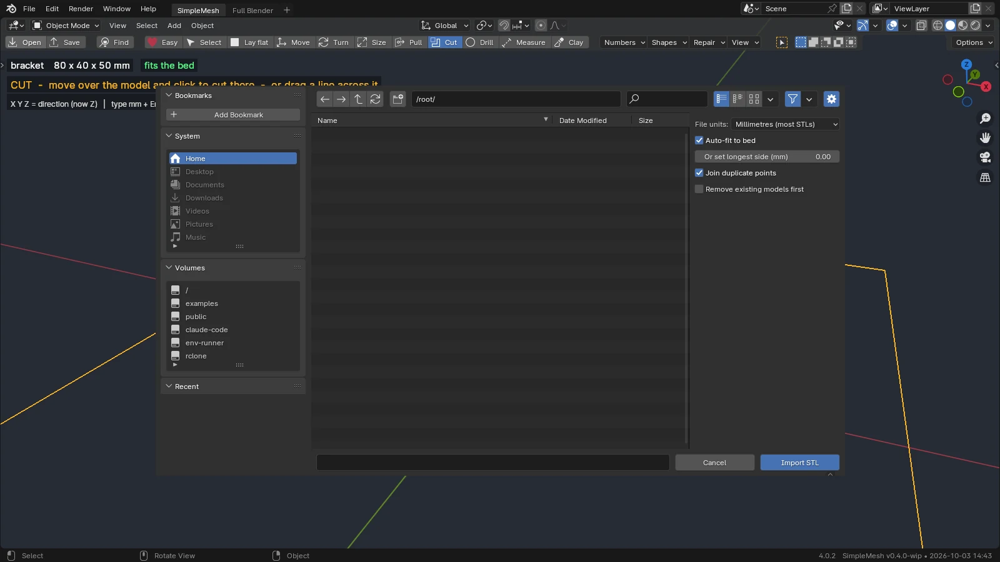 Open: choose the file's units here |

Why the tools are like this, and which existing add-ons and programs they were modelled on: [docs/DESIGN.md](docs/DESIGN.md).

## Install (one step)

Blender 3.0 or newer. Developed and window-tested on **4.0.2** (the version in Linux Mint 22 / Ubuntu 24.04's package manager).

1. Download `simplemesh-0.5.0-wip-installer.zip` from the release (or this whole repository) and unzip it.
2. Double-click the installer for your computer:

   | Computer | Double-click | or type |
   |---|---|---|
   | Linux Mint / Ubuntu | `Install SimpleMesh (Linux).sh` and choose *Run* | `python3 install.py` |
   | Mac | `Install SimpleMesh (Mac).command` | `python3 install.py` |
   | Windows | `Install SimpleMesh (Windows).bat` | `py install.py` |

3. In the window, tick the Blender you want and press **Install or update**. Then press **Open Blender**.

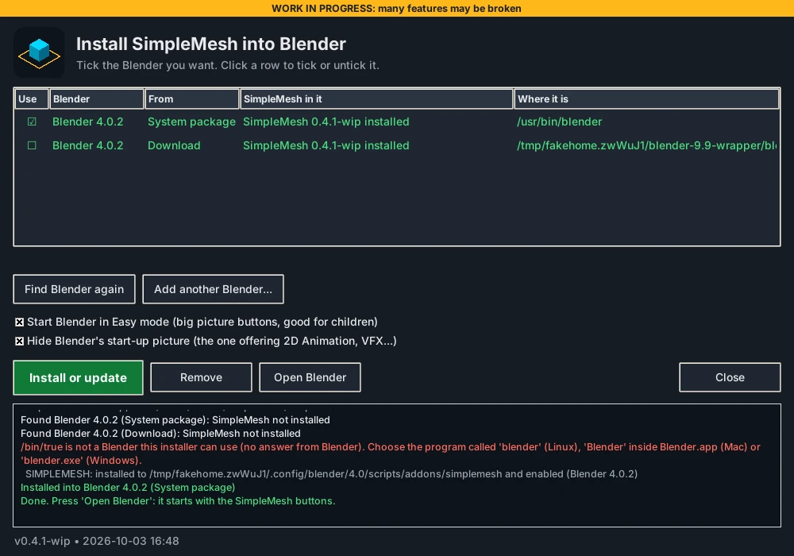

**What the window does**

- **The list** shows every Blender it found (system package, Snap, Flatpak, Steam, a downloaded folder, a Mac app), its version, and whether SimpleMesh is already in it and which version. Click a row to tick or untick it.
- **Add another Blender...** lets you point at a Blender it did not find (choose the program called `blender`, `Blender.app` or `blender.exe`). Anything that is not Blender is refused.
- **Start Blender in Easy mode** and **Hide Blender's start-up picture** are ticked to begin with; untick them if you want the panel's tools only, or Blender's usual welcome picture.
- **Install or update**, **Remove**, **Open Blender**. The box at the bottom says what happened.
- Blenders with the same version number (say, two copies of 4.0) share one settings folder, so installing into one installs into both; the list shows that.

**`install.py` always shows you something.** Run with no options it opens the window above. If this computer's Python has no window toolkit (tkinter), the same chooser appears as ordinary desktop dialog boxes instead (Linux, using `zenity`), and it tells you how to get the full window (`sudo apt install python3-tk`). With no desktop at all it asks in the terminal, with a numbered list of the Blenders.

**Without any window:** `python3 install.py --cli` asks in the terminal which Blender; `--cli --all` installs into every Blender with no questions; `--list` only shows them; `--blender /path/to/blender` picks one; `--remove` takes it out; `--no-easy` and `--keep-splash` are the two options.

**By hand:** in Blender, *Edit ▸ Preferences ▸ Add-ons ▸ Install…* (4.2+: the ▾ menu ▸ *Install from Disk…*), pick `simplemesh-0.5.0-wip.zip` (from the release, or `python3 tools/build_zip.py`), tick **SimpleMesh**, then *File ▸ New ▸ General*.

Upgrading from an older version: run the installer again (it replaces the old copy and the list shows "update to ...").

**Going back to normal Blender:** click the **Full Blender** tab at the top (an untouched stock layout), or untick *Tidy Blender when it starts* in the add-on's preferences. Files you already saved are never rearranged.

## What is tested and what is not

**Tested in a real Blender 4.0.2 window** (virtual display, simulated mouse and keys, 114 checks, `tests/gui_session.py`; the first part drives the tools through the thin strip with the panel off, the last part drives the panel): **Easy mode as a scripted child's session**: Blender starts in it; Block is picked up and put down; a Ball is put on top of the Block and lands on it; clicking selects; pulling dots makes the block taller, bigger and spins it; dragging slides it; colour, Copy, Bin; a loop drawn with the mouse becomes a solid; Ideas places a rocket; Glue makes it one closed model; Undo; the arrow buttons and right-drag turn the view; the Clay button and Done; Print! glues, repairs, sits everything on the bed and opens the save box; a saved project reopens in Easy mode. Then the strip tools: start-up tidy (one 3D view, millimetres, two workspace tabs); import of a 5200 mm STL lands centred and sensibly sized on screen; view re-centres after scaling; **F** finds a model 4.7 m away; every strip tool by click/drag/keys (lay flat by hover+click, move by drag and arrow key, turn by drag and by key, size by typing and by drag, cut by click and by dragging a line, pull a face by typing and by dragging, hole with typed diameter, measure); Clay: entering from the strip, millimetre brush size, a Pull stroke stretching a flat face from 20 to 39 mm, switching to Push in, Ctrl+Z after the first stroke staying in Clay and taking back just that stroke, redo, Done merging flat areas and leaving the model watertight; Sculpt Mode entered the way Blender's own mode menu does it being noticed, set up automatically (small triangles, automatic detail, the Pull brush in millimetres) and a drag then pulling the block from 20 to 39 mm; undo of a tool step; switching tools from the strip while a tool is on; the four pop-ups and the Open file chooser appear. **The panel**: its mouse watcher starts by itself; a click on the Lay flat key starts the tool, lights the key and turns the red button into FINISH LAY FLAT; the red button finishes it; clicks on the panel do not reach the model behind it; the red button starts Clay and the keys become brushes; Brush +, a brush key, a stroke in the view, the Undo key (the stroke goes, Clay stays), DONE; the Luminous key; Hide clutter and back; the Easy key, a picture button under the panel, a panel tool started from Easy mode and Easy mode taking over again afterwards; a recovery copy written while the panel is watching the mouse. **The installer window** was driven the same way (`tests/test_installer_gui.py`, 20 checks): it found and questioned two Blenders, ticking and unticking rows, refusing a program that is not Blender, Install, the two options, Remove, and Open Blender all worked, and Blender then started normally with the add-on on. Plain `python3 install.py` and the Linux launcher script both opened the window (`tests/test_install_launch.py`, 14 checks, starts `install.py` as its own program and looks for its window). With tkinter switched off, the dialog-box version (zenity) was clicked through an install by hand-placed mouse clicks, and the terminal version picked Blender number 1 from its list.

**Also tried by hand with real mouse and keyboard events** (sent through the display server with `xdotool`, not Blender's own event simulation; Blender 4.0.2 started normally after the installer; these sessions are not part of the repository's tests): placing a block and pulling a dot; opening a 234-triangle bracket and a 327,680-triangle model through the real file chooser; Lay flat on the bracket; a long Clay Pull stroke on both; **Sculpt Mode chosen from Blender's mode menu** (in 0.4.2 two long drags changed nothing you could see, in 0.4.3 the set-up runs and the drag pulls a horn out); Ctrl+Z after one and after two Clay strokes; Undo pressed until nothing was left, then adding a shape; Edit Mode and *Back to the models*; **Report a problem** (which caught a real error in the first version of the undo repair). With **Blender 5.0.1** and version 0.4.2, placing a block, pulling a dot and a Clay Pull stroke worked the same way; nothing later than 0.4.2 was run in a 5.x window. **For 0.5.0, on a 1366 x 768 screen**: the panel's keys by real clicks (Lay flat and FINISH, MOULD LIKE CLAY, Brush + three times, Build up, strokes, the Undo key, DONE, Luminous, Hide clutter, More tools and its Exact numbers pop-up, Report a problem); four fast clicks on a picture button all counting; an 82,000-triangle model opened through the file chooser and moulded with five strokes (Blender stayed under 0.9 GB and DONE took under 8 seconds on this machine's software rendering). **The freeze**: with 0.4.3 the same model, five strokes and then *Finer everywhere* left Blender not answering for several minutes at 4 GB; that button no longer exists.

**Tested without a window** (`tests/test_headless.py`, Blender **5.2.2** as the `bpy` module, also with numpy disabled): all the mesh work behind the tools: import sizes and units, scaling, lay flat, every Easy shape is closed and the right size; hand-drawn outlines (clean loop, overshoot, figure-of-eight, scribble) always give a valid solid; words become closed letters; each of the five Ideas goes through Print! to one watertight model that fits the bed; glue with holes; cuts with any plane (volumes add up, caps watertight), pulling faces, refining for Clay and merging flat areas again, Clay set-up including all seven brushes on Blender 5.2's brush system, drilling through and blind holes, hole shapes, weld, separate, repair, simplify, export and re-import.

**Not tested:** any real person using it, and in particular **no child has tried Easy mode**: whether a ten-year-old finds the dots, the stacking and the wording obvious is exactly what a scripted mouse cannot tell me; the Words and Save pop-up boxes themselves (the operators behind them were run); screens smaller than 1366 x 768 (the picture buttons were looked at on 1600 x 900 and 1366 x 768 only); trackpads; the two reported problems on the computer where they were reported: "a drag only changes it slightly" (0.4.3: reproduced here by choosing Sculpt Mode from Blender's own menu) and "on sculpt all controls lock up" (0.5.0: reproduced here with *Finer everywhere*), so in both cases I fixed something that matches the description without being able to check that it is what happened there; **the panel, the look keys and every other 0.4.3 and 0.5.0 change in a window on any Blender other than 4.0.2** (on 5.2 only the windowless tests, where the panel is laid out and its buttons run but nothing is drawn or clicked); Blender 3.x and 4.1 to 4.5 in any form; the panel on high-resolution (Retina / 4K scaled) screens, on two monitors or in more than one Blender window; the recovery copy over a real working session (it was written once on demand and once by its timer); Clay on models above about 330,000 triangles and on slow computers; the dense-model path above 700,000 triangles; large real-world STLs (hundreds of thousands of triangles: hovering builds a lookup of the model first, which may pause for a few seconds); the full scripted window session on Blender 3.x, 4.2+ or 5.x (only the windowless tests ran on 5.2); a real double-click on `install.py` or the launcher in a desktop file manager (they were started from a command line on a virtual display; the 0.4.2 fix for "`install.py` shows nothing" was not confirmed on the computer where it was reported); macOS and Windows, including the Mac and Windows double-click launchers and the "Add another Blender..." file chooser box itself; flatpak/snap/Steam Blender with the installer (the search for them is written but there was none here to find); the extension-format zip; the GitHub workflows.

## Known limitations

- **Easy mode** rests a shape on the surface under the mouse using the shape's bounding box, so on slopes and curves it sinks in a little (deliberately, so Glue has something to join). Shapes do not stay stuck when you move the one underneath until you Glue them. Dots act on one shape at a time. A drawn outline that crosses itself keeps its biggest loop.
- If Glue cannot merge two shapes cleanly it keeps them together as one model without merging; slicers normally cope, and Print! runs a repair.
- **No connectors.** Cut makes flat cuts. For pins, dovetails and snap fits use Easy-Print, EasySlice Print, PrintSplit or SnapSplit (see [docs/DESIGN.md](docs/DESIGN.md)).
- Hole, Weld and Cut-the-holes-out use Blender's exact Boolean: they need closed, non-self-intersecting models. Run **Repair** first if the result is odd.
- **Pull** moves a whole flat face along its own direction; neighbouring walls stretch with it. It cannot pull out part of a face (no sketching), and pushing a face in past the opposite side turns the model inside out (Ctrl+Z).
- Leaving Clay by picking another mode from Blender's own mode menu, instead of pressing **Done**, skips the tidy-up: the model keeps its small triangles. Go back into Clay and press Done, or use Repair ▸ Simplify.
- **Clay** adds a lot of triangles while you work (tens of thousands). Done merges the flat ones again, but moulded areas stay dense; use Repair ▸ Simplify if the file is too big. Very thin pulled shapes may be too thin to print. On models over about 120,000 triangles the "small triangles everywhere" step is skipped; over 700,000 automatic detail is off too and you mould the points the model already has. Each long pull on a small model can add tens of thousands of triangles: watch the count in the read-out.
- Lay flat and Pull highlight *flat* areas; on curved, organic surfaces it will pick a single triangle.
- Cut caps with triangle fill; very complicated cut outlines may cap imperfectly. Use Repair ▸ Check afterwards.
- Auto-fit on import divides by powers of ten; it cannot tell inches from millimetres by itself. Choose *File units* in the Open dialog, or use **Numbers ▸ inch → mm**.
- Round holes only. The bed is a flat outline, and "fits the bed" does not try other orientations.
- **The panel** needs Blender 3.2 or later (older versions get the thin strip). It covers the top of the 3D view; it is also there in the *Full Blender* tab. A small part of SimpleMesh watches the mouse all the time to make its buttons work, and Blender skips its own timed recovery save while that is so; SimpleMesh writes the copy instead, but only between drags, so a very long single stroke is not covered.
- **Hide clutter** leaves Blender's top bar (File, Edit, the workspace tabs) in place. The number fields of Clay (Size, Strength, Detail) are in the header row, so they are hidden with it; Brush + and Brush - still work.
- On Blender older than 4.2 the sidebar's SimpleMesh tab cannot be opened automatically; everything is reachable from the panel and the pop-ups anyway.

## Troubleshooting

| Symptom | Try |
|---|---|
| No picture buttons | Press the **Easy** key on the panel. They only show in the normal (Object) mode |
| A new shape will not go where I want | It sits on whatever is under the mouse; turn the view with the arrow buttons so you can see the place |
| I pulled a dot and it went wrong | **Undo** |
| Blender stopped answering while moulding | In 0.4.x the *Finer everywhere* button could do this (see the changelog); it is gone in 0.5.0. If it happens again: start Blender, **More tools ▸ Report a problem** and paste the text; it includes the last lines of what SimpleMesh was doing before. Your work: *File ▸ Recover ▸ Auto Save* |
| No panel of big buttons | **View** pop-up in the header row ▸ tick *Big-button panel*. It needs Blender 3.2 or later |
| No strip of tools | You are in Edit Mode (press Tab), or Blender's "tool settings" bar is hidden: View menu ▸ *Tool Settings*. Check the add-on is ticked in Preferences. |
| I ran `install.py` and nothing appeared | That was version 0.4.1 or older, where `install.py` was a terminal-only tool and the window was `install_gui.py`. From 0.4.2 `python3 install.py` opens the window. If still nothing: open a terminal in the folder, type `python3 install.py` and send me what it prints |
| The installer lists no Blender | Press **Add another Blender...** and choose the Blender program; or install the zip by hand |
| Double-clicking the Linux installer opens a text editor | Right-click ▸ *Properties ▸ Permissions ▸ Allow executing as program*, or type `python3 install.py` in a terminal in that folder |
| Mac says the installer "cannot be opened" | Right-click it ▸ *Open* the first time |
| Add-on will not switch on, mentions `numpy` | You have 0.1; this version no longer needs numpy |
| Model is a speck or a giant | **Numbers** ▸ ÷10 / ×10 / inch → mm, or **Size** and type the size you want |
| Cannot see the model | **F** |
| Clay: the surface will not move, or only a little | Look at the amber line in the view: it names the brush Blender is really using. If it says *Blender's own brush*, click a brush key on the panel. If the red button says *GET READY TO MOULD*, press it. Otherwise you are at the edge of the brush: make the brush bigger (F) or raise Strength. For fine work press *Finer everywhere* |
| The red button says BACK TO THE MODELS and the tool keys are grey | You are in one of Blender's own modes (Edit Mode, Vertex Paint...), reached from the mode menu at the top left or with Tab. The SimpleMesh tools are not there; press the button |
| Something does nothing, or looks wrong | **View ▸ Report a problem** copies the details I need (Blender version, graphics card, any errors caught). Paste them into your message or a GitHub issue |
| A tool does nothing when I click | Click **on** the model; clicks on empty space only select/deselect |
| Hole or weld gives a strange result | **Repair**, then try again |
| I want the timeline / outliner back | **Full Blender** tab at the top |

Please report problems with the [bug report form](../../issues/new/choose).

## More

[docs/DESIGN.md](docs/DESIGN.md) · [HOW_IT_WORKS.md](HOW_IT_WORKS.md) · [CHANGELOG.md](CHANGELOG.md) · [CONTRIBUTING.md](CONTRIBUTING.md) · [SECURITY.md](SECURITY.md)
